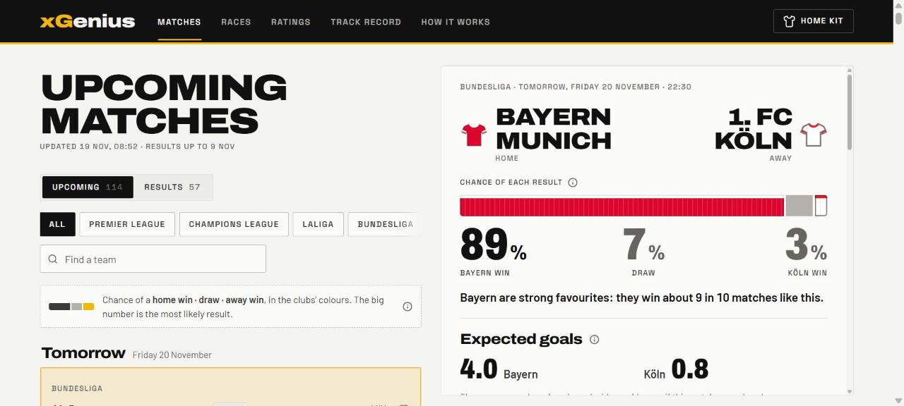

# ⚽ xGenius

Football match forecasts from statistical models: home/draw/away chances, likely scorelines, expected goals, over/under 2.5, both-teams-to-score, and season-end races for top scorers, assists and clean sheets. Every number is backtested, and the track record, misses included, is public. It's a stats project, not a betting tool: no odds shown, no tips, no affiliate links.



**Coverage** (edit `config/coverage.json`):
- Every match: Premier League, Champions League
- Big clubs only: Bayern, Dortmund · Juventus, Inter, Milan, Napoli, Roma, Lazio · PSG · Barcelona, Real Madrid, Atlético

Models train on **all** matches in 15 European leagues plus the Champions League; the coverage file only controls what's shown.

## What the site shows

| Page | What |
|---|---|
| **Matches** | Next three weeks of fixtures. Each one's home/draw/away split is drawn in the two clubs' shirt colours; open a match for xG, the most likely scores, a 6×6 score grid, over 2.5 / BTTS / clean-sheet chances, recent form and how confident the model is. **Results** shows each recent match against its pre-kickoff forecast. |
| **Races** | Projected end-of-season Golden Boot, assists and clean-sheet tables per competition, with a likely range and each contender's chance of finishing top. |
| **Ratings** | Every club on one cross-league scale (expected goal difference vs an average Champions League side). |
| **Track record** | Live record, this season replayed, the eight-season backtest, calibration and per-league results. |
| **How it works** | The method in plain language. |

## How accurate it is

Walk-forward backtest: each matchday predicted using only matches played before it, then scored against the result. Test period 2018/19–2025/26 (8 seasons, 15 leagues, 32,123 matches with Pinnacle closing odds). Lower log loss is better; a change only goes in if it beats the current best. Reproduce with `python -m predictor.backtest`.

| Model | Log loss | Brier | RPS | Accuracy | Notes |
|---|---|---|---|---|---|
| **xGenius** | **0.9703** | **0.5769** | **0.1960** | **53.1%** | Elo + Dixon-Coles, plus pre-match odds where available (81% of matches) |
| xGenius, stats only | 0.9829 | 0.5855 | 0.2000 | 52.2% | Elo + Dixon-Coles, no odds |
| Elo | 0.9845 | 0.5864 | 0.2004 | 52.3% | |
| Dixon-Coles | 0.9858 | 0.5873 | 0.2007 | 52.1% | |
| Base rate | 1.0735 | 0.6497 | 0.2306 | 43.5% | league averages; the floor |
| _Pinnacle closing odds_ | _0.9646_ | _0.5730_ | _0.1941_ | _53.6%_ | _benchmark only: exists only at kickoff_ |

On the 25,951 matches with pre-match odds, xGenius scores **0.9591**: better than those odds on their own (0.9606) and close to the sharpest bookmaker's closing line (0.9561). Forecasts are calibrated: when xGenius says 60%, it happens about 60% of the time (chart on the Track record page).

- **Champions League** 2024/25–2025/26 (378 matches, no odds available): 0.9171 log loss, 56.6% accuracy (base rate 1.0121).
- **This season so far** (289 covered matches, replayed): 0.8337 log loss, 63.7% accuracy.
- **Season races:** rest-of-season clean sheets projected from 19 Nov 2025 were off by 2.1 per team (3.3 for extending each team's pace); team goals 5.75 vs 7.39. Player goal/assist projections can't be backtested (no historical mid-season scorer data on the free tier); they blend this season with last season's scoring share.

## Architecture

```
GitHub Actions (every 6 h, free)                     Cloudflare Pages (free, static)
  ingest → fit Elo + Dixon-Coles → blend     ──▶     web/ reads web/public/data/*.json
  → commit web/public/data/*.json                    (redeploys on every push)
```

No always-on server, no database, no cold starts. A weekly job re-runs the backtest and refits the ensemble weights.

## Models

- **Elo** (`models/elo.py`): per-league ratings with a goal-difference multiplier, season regression and a promoted-team penalty; an ordered logit turns rating gaps into home/draw/away.
- **Dixon-Coles** (`models/dixon_coles.py`): Poisson goals with the low-score correction, fitted jointly on every league and the Champions League, time-decayed (half-life 300 days), ridge-regularised. This season it also learns from xG (50% weight). It gives the score grid, xG, over/under and BTTS.
- **Cross-league strength:** each team's attack and defence is a country offset plus a team effect. Champions League matches pin down the country offsets, which puts every club on one scale. Clubs from countries we don't ingest (Slavia, Qarabağ, Kairat...) share an "other" group and are flagged low-confidence until they've played enough.
- **Ensemble** (`models/ensemble.py`): two logarithmic pools with per-outcome calibration. *Stats* (Elo + Dixon-Coles, with its own Champions League calibration) is used when no odds exist; *market* (Elo + Dixon-Coles + pre-match market-average odds, margin removed) is used once odds are published, usually a few days before a league round. Both are refitted every season on out-of-sample predictions only. The score grid is rescaled to match the final home/draw/away.
- **Goal calibration:** above 2.0 expected goals, Dixon-Coles rates grow at 0.777× (fitted on 2018–23 by Poisson likelihood). On 2023–26 it fixes the top bins (forecast 3.0–3.5 → 2.93 vs 2.97 actual; 3.5+ → 3.43 vs 3.13, was 3.84) and improves exact-score log loss in big-favourite matches (3.0439 → 3.0373), at +0.0003 over-2.5 log loss. Applied to xG, the score grid, goal markets and races; win/draw/loss chances were already calibrated and are unchanged.
- **Season races** (`races.py`): 20,000 simulated rest-of-seasons from the Dixon-Coles outlook for every remaining fixture. A player's share of team goals blends this season with last season in the same competition: `(goals + 40 × last share) / (team goals + 40)`; players new to the competition use `goals / (team goals + 3)`. The prior weight (40 team goals) is a judgement call: there's no historical mid-season scorer data to tune it on. Clean-sheet chances are scaled by 0.935 to correct a bias measured on 2022–24.

Tried and dropped: gradient boosting (nothing to add on top of model outputs and odds), league-specific calibration for domestic leagues (overfits; kept for the Champions League, where it helps), refitting Dixon-Coles every 3 days instead of 7 (no gain).

## Data

| Source | Gives us | Notes |
|---|---|---|
| [football-data.co.uk](https://football-data.co.uk) | Results, xG (2026/27), historical odds, pre-match odds for upcoming matches | Free CSVs, 15 leagues from 2014/15. |
| [football-data.org](https://www.football-data.org) | Fixtures, Champions League results, top scorers | Free API key, 10 requests/min. CL results from 2023/24 on the free tier. Scorers: top 100 per competition; players without a goal aren't listed, so the assists race misses pure creators. |

- **Odds:** `odds_pre_*` (market average collected before kickoff) is a model input. `odds_close_*` and `pin_close_*` (closing odds) are for evaluation only: using them would be leakage.
- **xG:** checked against results (total goals 1.016× total xG, correlation 0.61 per match). Blending it in improved log loss by 0.0023 ± 0.0025 on Sep–Nov 2026: positive, not yet significant. **Re-check at the end of 2026/27.**
- **Knockouts** use the 90-minute score; extra time and penalties would distort a goals model.
- **Team names:** every spelling is normalised (accents, punctuation, "FC" etc. stripped) and looked up in `config/teams.csv`; a test fails if one alias points at two teams. Club colours live in `config/kit_colours.csv`.
- **API rate limit:** the client follows football-data.org's rate-limit headers and retries once after a 429.

## Repo layout

| Path | What |
|---|---|
| `config/` | `coverage.json` (what's shown), `teams.csv` (name mapping), `kit_colours.csv`, `ensemble.json` (fitted weights) |
| `predictor/ingest/` | Downloaders (cached) + `python -m predictor.ingest` |
| `predictor/models/` | Base rate, Elo, Dixon-Coles, ensemble (`fit` / `predict` / `update` contract) |
| `predictor/backtest.py` | Walk-forward backtest, tuning, ensemble fitting; writes `performance.json` |
| `predictor/publish.py` | Fits on everything known today; writes predictions, history, ratings, races |
| `predictor/races.py` | Season-end projections |
| `web/` | React + Vite site; `web/public/data/` is the published data |
| `.github/workflows/` | `update.yml` (every 6 h), `backtest.yml` (weekly), `ci.yml` (tests + build) |
| `PRODUCT.md`, `DESIGN.md` | Who the site is for, and its design system |
| `tests/` | pytest suite |

## Run it locally (Windows / PowerShell)

Requires Python 3.11+ and Node 22+.

```powershell
python -m venv .venv
.venv\Scripts\Activate.ps1          # if blocked: Set-ExecutionPolicy -Scope CurrentUser RemoteSigned
pip install -r requirements.txt
copy .env.example .env              # then add your free football-data.org key

python -m predictor.ingest          # results, fixtures, scorers, upcoming odds
python -m predictor.backtest        # ~2 min: leaderboard, performance.json, ensemble weights
python -m predictor.publish         # predictions, history, ratings, races
pytest

cd web
npm install
npm run dev
```

## Deploy (Cloudflare Pages)

1. **API key secret.** GitHub repo → *Settings* → *Secrets and variables* → *Actions* → *New repository secret*: name `FOOTBALL_DATA_API_KEY`, value = your football-data.org key.
2. **Merge to `main`.** Scheduled workflows only run on the default branch.
3. **Cloudflare Pages.** dash.cloudflare.com → *Workers & Pages* → *Create* → *Pages* → *Connect to Git* → `xGenius`:
   - Production branch `main` · Root directory `web` · Build command `npm run build` · Output directory `dist`
   - Environment variable `NODE_VERSION` = `24`
4. **First data run.** GitHub → *Actions* → *Update predictions* → *Run workflow*. It then runs every 6 hours; *Weekly backtest* runs on Mondays.

## Roadmap

1. [x] Repo restructure
2. [x] Data ingestion + team-name mapping
3. [x] Backtest harness + Elo baseline
4. [x] Dixon-Coles Poisson
5. [x] xG features (re-check after a full season)
6. [x] Ensemble + calibration + pre-match odds
7. [x] Champions League cross-league strength
8. [x] Automated pipeline (GitHub Actions → static JSON)
9. [x] Frontend
10. [x] Season races: top scorers, assists, clean sheets
11. [ ] Deployment (Cloudflare Pages): steps above

**Ideas:** over/under odds to sharpen the goals markets, a fuller assist source, goalkeeper clean sheets (needs lineups). **Parked:** user predictions + "beat the model" leaderboard.
